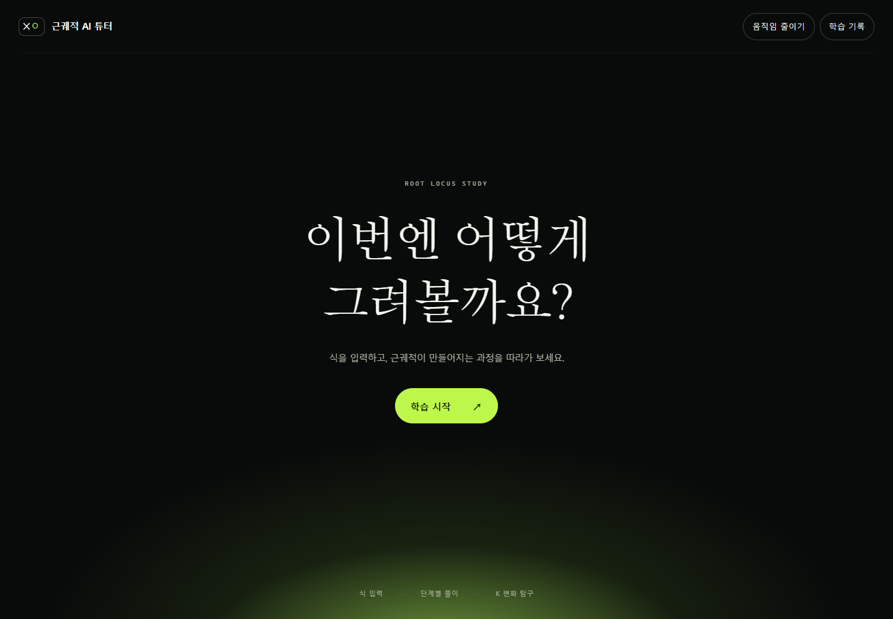
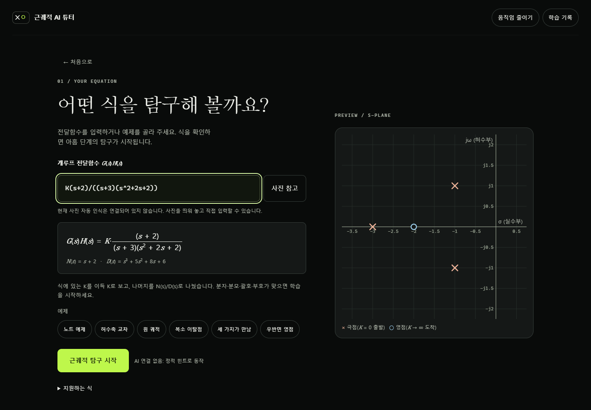
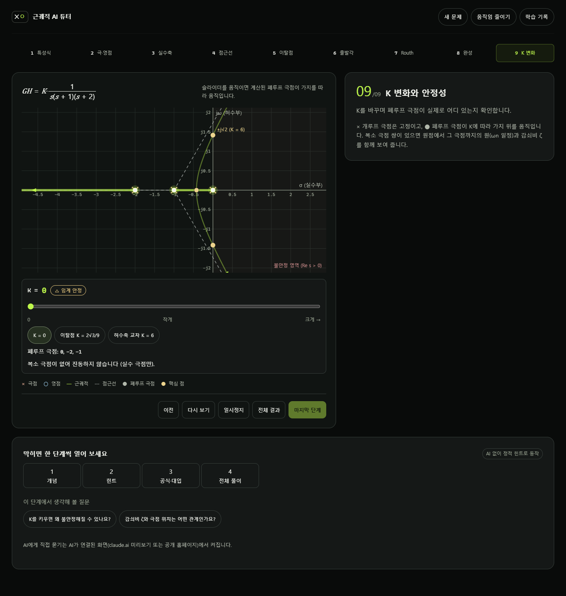
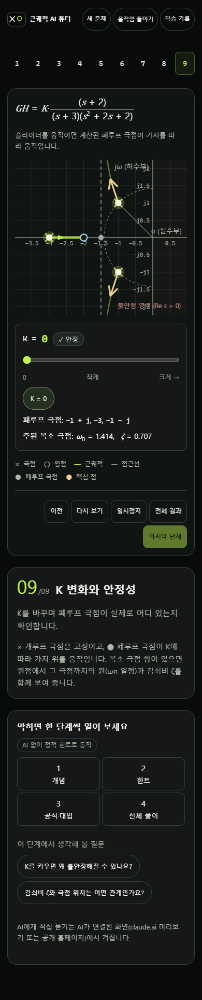

# 근궤적 튜터 — Quiet depth 완료·검증 기록

2026-11-12 KST · 담당: GPT (ChatGPT/Codex). 이 문서는 구현 결과를 기록하며, 후속 모델의 작업 지시문이 아닙니다.

## 기준 버전과 변경 범위

GitHub 조회 시 PR #3은 열린 초안, head `gpt/gesture-welcome` / `be3d7b9802749c3383e2838d927b1250a5963cdc`, base `gpt/tutor-bugfixes`였습니다. main은 이 head보다 3커밋 뒤이며 #3을 포함하지 않았습니다. #1·#2의 브랜치는 각각 2·1커밋 뒤입니다. `gpt/studio-ui`는 main에서 갈라진 별도 작업으로 #3을 포함하지 않았고 수정하지 않았습니다.

빈 작업 폴더에서 시작했습니다. Git clone은 네트워크 권한 부여 후에도 Windows Git credential-manager 실행 오류로 실패했습니다. GitHub 연결 도구로 고정 커밋의 텍스트를 가져왔으며, 가져오기 때 생긴 마지막 빈 줄을 원본 바이트와 대조해 정리했습니다. 로컬 Git은 검사용 텍스트 스냅샷 이력입니다. 원격 커밋은 기존 GitHub 트리를 기반으로 생성하여 기존 이미지·다른 파일·실제 부모 이력을 보존합니다. main 병합·강제 푸시·배포는 하지 않았습니다.

계산 엔진 `js/`, `app/js/graph.js`, parser/content/ai와 기준 정답은 원본과 동일합니다. 수학 오류 수정은 없습니다. 9단계 순서, 계산값, K=0, 정적 힌트, 사진 확인 후 적용 흐름을 보존했습니다.

| 구분 | 변경 파일 | 결과 |
|---|---|---|
| 디자인 | `app/app.css`, `app/template.html` | 흰 제목, 하단 조명, 의미색, 범례, 중립 패널 경계, 그래프 높이 |
| UI 기능 | `app/js/main.js` | 그래프 아래 단일 K 조작부, 실제 K 읽기 값, 상태 기호, 장식 프레임 취소 |
| 기록 방어 | `app/js/store.js` | 손상된 기록 항목 제외. 저장 데이터 구조·K 저장 범위는 확대하지 않음 |
| 빌드 | `tools/build.py`, `dist/rootlocus-tutor.html` | 소스 입력 SHA-256 메타데이터, 단일 HTML 재생성 |
| 검사 | `tools/design-check.py`, `tools/smoke.py`, `tests/results.json` | 파일·오프라인·반응형·접근성 회귀 검사, 기존 smoke의 무검사 통과 방지 |
| 문서·증거 | 본 문서, `docs/할일.md`, `docs/AI-사용기록.md`, `docs/shots/quiet-depth/` | 담당·AI 범위·동일 빌드 캡처·검사 JSON |

## 실제 색상 토큰

| 역할 | CSS 토큰 | 값 |
|---|---|---|
| 배경 / 패널 / 보조 패널 | `--bg` / `--surface` / `--surface2` | #090B0A / #151817 / #1D2220 |
| 패널 테두리 / 그래프 격자 | `--line` / `--grid` | #363E3A / #252D29 |
| 본문 / 보조 / 약한 글자 | `--fg` / `--muted` / `--faint` | #F3F5EF / #B1B8AB / #9BA593 |
| 키보드 포커스 | `--focus` | #D7F7A4 |
| 주요 행동·현재 단계 / 버튼 위 글자 | `--accent` / `--accent-ink` | #BEF74B / #152007 |
| 극점 × / 영점 ○ | `--pole` / `--zero` | #EFB49A / #9ACBE8 |
| 근궤적 / 점근선(파선) | `--locus` / `--asym` | #BEF74B / #A8AEAA |
| 핵심 점 / 제외 후보 | `--key` / `--rej` | #ECD38D / #9DA697 |
| 안정 / 경고·임계 / 오류·불안정 | `--ok` / `--warn` / `--bad` | #B8D8CB / #E7C77E / #FFADAD |

폐루프 극점은 기존 흰 ●와 궤적색 외곽선을 유지합니다. 핵심 점도 실제 그래프에 맞춰 금색 ●로 표기합니다. 안정은 `✓ 안정`과 옅은 채움, 임계는 `△ 임계 안정`, 불안정은 `! 불안정`으로 구분합니다. 설명의 `.ref`, SVG 기호와 범례가 같은 토큰을 사용합니다. 광원은 첫 화면에만 있고 학습 그래프에는 장식 배경이 없습니다.

## 동작과 사용성

- 첫 화면: 요청 문구, 흰색 두 줄 제목, 하단 중앙 광원. 사진·영상·3D 라이브러리 없음. 캡처에서 빛이 제목 뒤로 번지지 않는 것을 확인했습니다. 이것이 모든 사용자의 시각적 편안함을 보증하지는 않습니다.
- 포인터: 빛만 x 최대 약 14px, y 약 10px, 중심 레이어 회전 약 1.5도. 넓은 레이어는 이동량 55%. transform 전환 540ms, 이벤트를 rAF 한 번으로 묶고 자체 반복 루프는 없습니다. 포인터 이탈·화면 이동·탭 숨김·모션 축소 시 대기 프레임과 위치를 초기화합니다.
- 실제 스크롤이 생긴 짧은 첫 화면에서만 광원 이동 최대 12px. 스크롤 가로채기나 페이지 길이 추가 없음. 터치 포인터의 커서 효과는 생략합니다.
- 버튼 160ms, 내용 440ms, 화면 540ms. 화면은 즉시 전환되어 입력 가능하고 전환 종료 타이머로 다시 나타나지 않습니다. 제목·입력·그래프에 지속적인 기울임 없음.
- K 조작부는 모든 크기에서 그래프 바로 아래 한 곳에만 존재합니다. 9단계 외에는 제거되며, 단계 왕복 중 K=0을 유지합니다. range의 보조기술 읽기 값은 0~1000의 내부 위치가 아닌 실제 K와 안정 상태입니다.
- 좁은 화면에서 그래프·K → 단계 설명 → 힌트 순서입니다. 그래프 고정 배치를 제거해 설명·키보드를 가리지 않도록 했습니다. 실제 브라우저 키보드와 안전 영역은 실기기 확인이 남았습니다.
- 기록은 식·마지막 단계·완료 여부·날짜를 저장합니다. K는 저장하지 않는다고 기록 창에 명시했습니다. 첫 화면에 추가 이어서 보기 버튼은 만들지 않았으며 기존 학습 기록의 이어서 보기를 유지합니다. 잘못된 JSON/항목을 안전하게 제외하며 해석 불가능한 식을 복원하면 입력 화면에서 오류를 보여 줍니다.
- 제목은 시스템 명조(`Noto Serif CJK KR`, `AppleMyungjo`, `Batang`, Georgia, serif), 본문·수식·고정폭도 일반 계열 fallback을 지정합니다. 글꼴 파일·외부 요청·라이선스 재배포 추가 없음. 발표 PC와 iPad의 글꼴 모양은 달라질 수 있습니다.

## 재현 명령과 결과

저장소 루트에서 실행합니다. Windows Python 3.12.10, Node 24.22.1. Playwright는 검사 환경에만 설치했으며 실행 HTML에는 포함하지 않았습니다.

```powershell
node tests/run-tests.js
node tests/ui-regressions.js
node --check app/js/main.js
node --check app/js/graph.js
python tools/build.py
git diff --check
python tools/design-check.py
python tools/smoke.py
Get-FileHash dist/rootlocus-tutor.html -Algorithm SHA256
```

브라우저 검사에는 Python Playwright 및 Chromium/Edge/Chrome 중 하나가 필요합니다. 이 작업 환경에서는 프로젝트 밖 `work/python-deps`에 Playwright를 설치해 `PYTHONPATH`를 지정했습니다. 일반 환경에서는 설치된 Playwright로 위 명령을 그대로 실행합니다.

| 검사 | 이번 빌드 결과 |
|---|---|
| 엔진 | 17/17 문제, 225/225 항목 |
| 기존 UI 회귀 | 6/6 |
| 두 JS 구문 / Python 빌드 / diff 공백 | 통과 |
| `tools/design-check.py` | 107항목 통과, 페이지·콘솔 오류 0, 외부 HTTP(S) 요청 0 |
| `tools/smoke.py` | 6예제 × 9단계, 내 답 확인·질문·힌트·예시 복귀·기록·오류 입력, 오류 0 |
| 파일 실행 | `file://` 단일 HTML, 네트워크 offline context, AI 없는 기본 학습·정적 힌트 성공 |
| 접근성 기능 | 오류 aria-invalid, 단계 aria-current, 입력 포커스, 기록 Tab/Shift+Tab/Escape 복귀, K 키보드 조작 |
| 회귀·상태 | K=0 단계 왕복, 예제 전환, 기록 단계 복원, 손상 기록 후 정상 시작, 12회 연속 화면 전환 |
| 모션 | 앱 설정 저장·재로드, OS 설정 에뮬레이션, 포인터 반응·이탈 복귀, 제목 무기울임 |
| 사진 | 테스트 PNG 로컬 선택·취소, 미연결 시 전송 버튼 숨김 및 직접 입력 안내. 실제 OCR은 미검증 |

최종 브라우저: Headless Chromium 157.0.8103.78 / Windows, `document.visibilityState = visible`. Chrome 창 수동 조작·Safari 검사와 구별합니다. 자동 검사의 54단계는 제목·현재 단계·오류 검사입니다. **54개 화면 전체의 시각 검수는 아닙니다.** 직접 캡처를 본 범위는 첫 화면·입력·오류/비활성/포커스, 9단계의 6개 그래프 형태(허수축 교차·원 궤적·복소 이탈점·중근 만남·우반면 영점 포함), 모바일 학습과 iPad 크기 화면입니다. 긴 설명·모든 상태×화면 조합의 전체 시각 검수는 남았습니다.

| viewport 모사 | 검사 화면 | 그래프 높이 | 그래프→K 간격 | 가로 넘침 |
|---|---|---:|---:|---:|
| 1440×1000 데스크톱 | 첫/입력/오류/학습/6형태 | 420px | 16px | 0px |
| 1194×834 iPad 가로 상당 | 첫/입력/학습 | 약 350px | 16px | 0px |
| 834×1194 iPad 세로 상당 | 첫/입력/학습 | 470px | 16px | 0px |
| 390×844 모바일 | 첫/입력/학습 | 300px | 16px | 0px |
| 360×740 작은 모바일 | 첫/입력/학습 | 300px | 16px | 0px |

iframe이 아닌 브라우저 viewport 크기 모사입니다. 실제 iPad·터치·Safari·화면 읽기 도구는 검증하지 않았습니다. 성능 평가용 Performance 기록·실제 입력 지연·프레임 표본은 수집하지 않았으므로 모션 성능은 미검증입니다. 기존 원격 rAF 중앙값 약 1016ms는 이 빌드의 성능 평가에서 제외하며 원인도 단정하지 않습니다. 60fps를 확인했다고 주장하지 않습니다.

## 빌드 식별과 동일 빌드 캡처

- 실행 소스 커밋: `924def501e3b92a3239232d02b1456167d1dcc6f` (기준 커밋 `be3d7b9…`의 자식).
- 작업 브랜치: `gpt/quiet-depth`. PR base: `gpt/gesture-welcome` (기존 PR #3 위의 후속 변경). main 병합은 주영님이 진행합니다.
- 빌드 명령: `python tools/build.py`.
- 실행 파일: `dist/rootlocus-tutor.html`, Windows 빌드 209,228 bytes (약 204.3 KiB). 기준 파일 203,197 bytes 대비 6,031 bytes 증가. 추가 글꼴·영상·외부 자산 0 bytes.
- 실행 파일 SHA-256: `46e66429ab6c2e02a5966f7c7cf037d06a7fb612240aade74de4aeff7a15f989`.
- HTML 메타데이터의 소스 입력 SHA-256: `fd9ae3c477e884d45d6588b18487fcbcfd1571e5ffea6bf3c1187b53a671af44`. 파일 자체 해시는 내부에 넣지 않습니다. OS별 줄바꿈 때문에 다른 OS 재빌드의 파일 바이트 해시는 달라질 수 있습니다.
- `docs/shots/quiet-depth/checks.json`에 캡처 대상 파일 SHA-256·브라우저·전체 검사 항목·viewport 측정값을 함께 기록했습니다. 이전 빌드의 결과를 재사용하지 않았습니다.






## 발표 PC에서 남은 확인

다운로드한 HTML의 SHA-256을 대조하고 파일로 열어 오프라인 예제 → 9단계 → K=0 → 단계 왕복을 확인합니다. 실제 발표 해상도·배율·한국어 글꼴, 포인터 조작감과 활성 탭 Performance 기록, iPad Safari 터치·키보드·안전 영역을 확인해야 합니다. 매우 큰 K/긴 식의 라벨 밀집과 그래프 경계 눈금 일부 잘림은 기존 그래프 배치의 한계로 남아 있으며 엔진이나 축 범위 계산을 디자인 목적으로 바꾸지 않았습니다. 사진 자동 인식·온라인 AI는 연결된 것으로 시연하지 않습니다.
