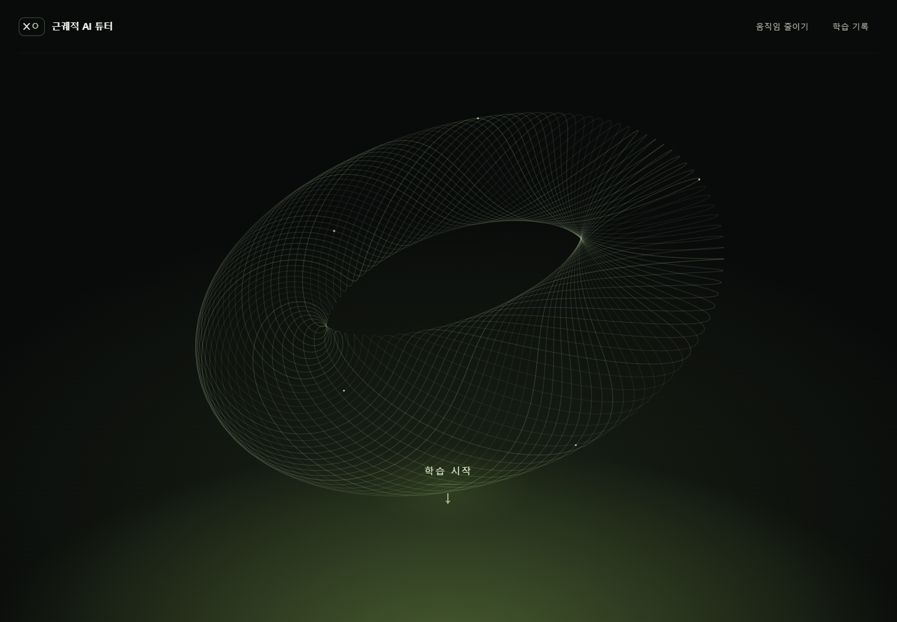
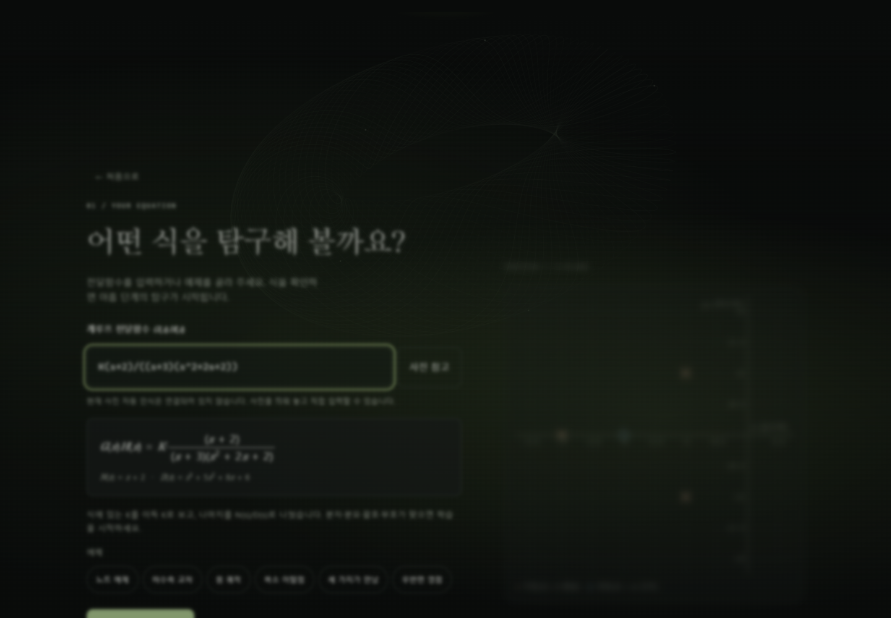
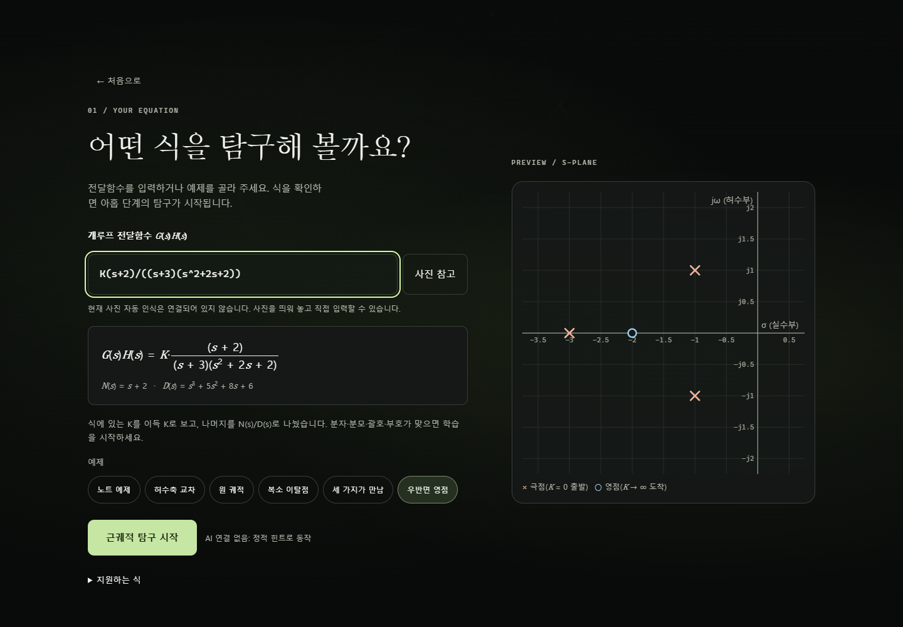
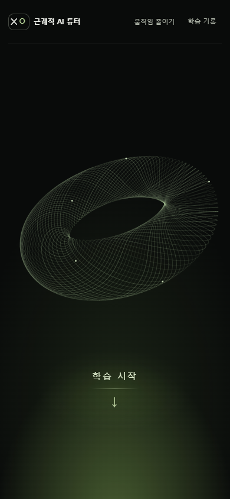

# 근궤적 튜터 — 수학적 공간과 스크롤 진입

2026-11-13 KST · 담당: GPT / ChatGPT·Codex. 실제 구현·검증 결과를 기록한 문서입니다.

## 이번 변경

사용자의 후속 요청에 따라 첫 화면의 큰 제목·설명·하단 안내를 제거하고, 계속 움직이는 수학적 곡면과 학습 시작 행동을 중심으로 바꿨습니다. 이전 버전의 ‘손을 멈추면 장식도 멈춤’ 방향은 이번 요청의 연속 모션으로 대체했습니다. 첫 화면과 식 입력은 한 문서 안에서 이어지며, 버튼을 누르면 실제로 아래로 스크롤합니다.

- 32개의 매개변수 곡선과 5개의 작은 이동점을 Canvas 2D로 그립니다. 세 번 비튼 토러스형 곡면을 투영한 장식이며, 실제 근궤적 계산 데이터가 아닙니다. 이미지·영상·CDN·3D 라이브러리·유료 생성 없음.
- 첫 화면은 작은 브랜드, 상단 보조 기능, 곡면, ‘학습 시작 ↓’만 보입니다. 화면 읽기용 제목은 유지했습니다.
- 시작 버튼은 테두리와 불투명한 배경을 없애고 빛·희미한 밑줄·아래 화살표와 결합했습니다. 포커스 표시는 유지합니다.
- 첫 화면과 입력은 동시에 문서에 존재합니다. `window.scrollTo`의 네이티브 smooth 동작을 사용하며 휠·터치를 가로채지 않습니다. 사용자가 직접 스크롤해도 입력으로 도달할 수 있습니다.
- 스크롤 진행에 맞춰 곡면은 위로 멀어지고 옅어지며, 넓은 빛은 왼쪽으로, 하단 광원은 오른쪽 위로 움직입니다. 같은 배경이 이어집니다.
- 입력과 프리뷰는 45px 이동·opacity·7px의 일회성 blur 전환으로 선명해집니다. 프리뷰는 110ms 뒤따릅니다. 도착 후 blur는 완전히 제거되며 조작을 잠그지 않습니다. 첫 화면으로 돌아온 뒤 재진입할 때도 다시 드러납니다.
- 입력·학습의 버튼 강조는 옅은 초록으로 낮추고 패널을 어두운 반투명 표면으로 맞췄습니다. 실제 궤적의 선명한 라임과 극점·영점 의미색은 유지했습니다.
- 터치 포인터에서는 입력칸 대신 입력 화면 제목에 포커스를 두어 자동 키보드 호출을 피합니다. 실제 기기 키보드 동작은 별도 검증이 필요합니다.
- 연속 그림은 첫 화면이 보일 때만 실행합니다. Canvas 그리기는 약 30Hz 상한을 두고, 입력 도착·학습 화면·숨겨진 문서에서는 rAF를 취소합니다. OS 및 앱의 움직임 줄이기에서는 정지 화면과 즉시 스크롤을 제공합니다. CSS 모션 축소도 유지합니다.

계산 엔진, 그래프 계산/렌더링 코드, parser/content/ai/store는 이번 후속 변경에서 수정하지 않았습니다. 기존 9단계·K=0 유지·그래프 바로 아래 단일 K 조작부·기록 복원·정적 힌트·사진 확인 후 적용 흐름은 유지합니다.

## 파일별 구분

| 구분 | 파일 | 내용 |
|---|---|---|
| 디자인 | `app/app.css`, `app/template.html` | 곡면 공간, 경계 없는 CTA, 연속 세로 구성, 안개 등장, 조화로운 버튼/패널 |
| 장식 구현 | `app/js/atmosphere.js` | 매개변수 곡면, 포인터·스크롤 반응, 가시성·모션 축소 수명 관리 |
| UI 동작 | `app/js/main.js` | welcome/input의 실제 스크롤 이동, 학습 전환, 터치 포커스 |
| 빌드 | `tools/build.py`, `dist/rootlocus-tutor.html` | atmosphere.js를 단일 HTML에 포함 |
| 검증 | `tools/journey-check.js`, `tools/design-check.py` | 이전 첫 화면 전용 검사를 현재 연속 화면에 맞춰 갱신. Python 진입점은 Node 검사 실행 |
| 성능 진단 | `tools/journey-performance.js` | 헤드리스 브라우저의 프레임 간격·긴 작업·렌더러 시간 수집 |
| 기록 | `tests/results.json`, 본 문서, `docs/할일.md`, `docs/AI-사용기록.md`, `docs/shots/mathematical-journey/` | 이번 실행의 결과·동일 빌드 캡처 |

## 색상·타이포그래피

| 역할 | 토큰 / 값 |
|---|---|
| 배경 / 패널 / 보조 패널 | `--bg` #090B0A / `--surface` #151817 / `--surface2` #1D2220 |
| 패널 경계 / 격자 | `--line` #363E3A / `--grid` #252D29 |
| 본문 / 보조 / 약한 글자 | `--fg` #F3F5EF / `--muted` #B1B8AB / `--faint` #9BA593 |
| 주요 행동 / 버튼 글자 / 포커스 | `--accent` #C6E6A4 / `--accent-ink` #152007 / `--focus` #D7F7A4 |
| 극점 × / 영점 ○ | `--pole` #EFB49A / `--zero` #9ACBE8 |
| 궤적 / 파선 점근선 / 핵심 점 | `--locus` #BEF74B / `--asym` #A8AEAA / `--key` #ECD38D |
| 제외 후보 / 안정 / 경고 / 오류 | `--rej` #9DA697 / `--ok` #B8D8CB / `--warn` #E7C77E / `--bad` #FFADAD |

폐루프 극점 ●, 범례, 안정 상태의 문구·기호·채움 방식은 유지합니다. 시스템 한국어 글꼴을 사용하며 각 font-family의 마지막은 serif/sans-serif/monospace 계열입니다. 글꼴 자산 추가 0 bytes. 발표 PC와 iPad의 실제 글꼴 모양은 다를 수 있습니다.

## 실행·검사 결과

Windows / Node 24.22.1 / Python 3.12.10 / Headless Chrome 157.0.8103.78. `file://`로 단일 HTML을 열고 offline context에서 검사했습니다. HTTP(S) 요청 0, 페이지·콘솔 오류 0.

저장소 루트에서:

```powershell
node tests/run-tests.js
node tests/ui-regressions.js
node --check app/js/main.js
node --check app/js/graph.js
node --check app/js/atmosphere.js
python tools/build.py
git diff --check
python tools/design-check.py
node tools/journey-performance.js
Get-FileHash dist/rootlocus-tutor.html -Algorithm SHA256
```

UI 검사에는 Node와 Playwright가 필요합니다. `python tools/design-check.py`는 설치된 Python Playwright의 Node 드라이버 패키지도 찾아 사용할 수 있습니다. Node Playwright를 별도 경로에 설치한 경우 `PLAYWRIGHT_MODULE`로 지정합니다. 이 환경에서는 work/python-deps의 기존 패키지와 work/pip-temp를 사용했습니다. 앱 실행에는 이 검사 의존성이 필요하지 않습니다.

| 검사 | 이번 결과 |
|---|---|
| 엔진 | 17/17 문제 · 225/225 항목 |
| 기존 UI 회귀 | 6/6 |
| JS 구문, Python 빌드, diff 공백 | 통과 |
| 파일·오프라인 UI | 118항목 통과 |
| 새 진입 흐름 | 손을 멈춘 뒤에도 계속 움직임, 실제 중간 스크롤 위치, 같은 문서의 두 구간, 최종 입력 위치·선명도 |
| 수명·접근성 | 입력/학습에서 Canvas 정지, 앱 설정 저장, OS 모션 축소, 즉시 이동, 키보드 포커스와 대화상자 Tab 순환 |
| 학습 회귀 | 6예제×9단계, K=0 왕복, 키보드 K, 기록 복원/손상 방어, 정적 힌트·질문·예시 복귀, 오프라인 사진 참고 |
| 빠른 조작 | 반복 입력/학습 전환, 빠른 시작→복귀→시작에서 마지막 스크롤 의도 유지 |

이전 `tools/smoke.py`의 Python 브라우저 드라이버는 이번 환경에서 시작 응답이 멈췄고 Edge는 임시 프로필 오류를 냈습니다. 기존 smoke 결과를 이번 빌드 결과로 재사용하지 않았습니다. 작업 폴더의 임시 경로와 Node Playwright + Chrome으로 실행한 위 118항목의 결과를 사용했습니다.

| 화면 크기 | 방식 | 첫/입력/학습 가로 넘침 | 그래프→K 간격 |
|---|---|---:|---:|
| 1440×1000 | 데스크톱 viewport | 0px | 16px |
| 1194×834 | iPad 가로 상당 + 터치 에뮬레이션 | 0px | 16px |
| 834×1194 | iPad 세로 상당 + 터치 에뮬레이션 | 0px | 16px |
| 390×844 | 모바일 viewport + 터치 에뮬레이션 | 0px | 16px |
| 360×740 | 작은 모바일 + 터치 에뮬레이션 | 0px | 16px |

54단계 자동 검사는 제목·현재 단계와 오류 검사이며 전체 54개 화면의 시각 검수가 아닙니다. 동일 빌드의 첫 화면·중간 전환·입력·모바일 학습을 캡처로 확인했습니다. 6가지 그래프 형태 및 각 viewport 캡처도 생성했습니다. 실기기 터치·Safari·화면 읽기 도구·가상 키보드·안전 영역·실제 탭 숨김 조작은 미검증입니다.

## 제한된 성능 진단

1440×1000 Headless Chrome, file:// offline, `bringToFront`, 측정 시작/끝의 `document.visibilityState=visible`. 첫 60프레임은 곡면, 이후 합성 클릭으로 입력 스크롤. 약 1.593초, rAF 간격 180표본: 중앙값 7.0ms, p95 27.8ms, 최대 62.4ms. 관측된 50ms 이상 long task 0건. CDP 누적 시간 차이는 Task 125.8ms, Script 20.6ms, Layout 0.54ms, RecalcStyle 18.4ms였습니다.

이는 헤드리스 스케줄러의 짧은 진단이며 실제 디스플레이 프레임률·입력 지연·발표 PC의 부드러움을 검증하지 않습니다. 60fps 보장이나 모든 프레임이 일정하다는 주장도 하지 않습니다. 원시 표본은 `performance.json`에 보존했습니다. 이전 원격 rAF 약 1016ms 측정은 사용하지 않았습니다.

## 빌드 식별

- 기준: PR #4 head `8cf7e0f9dcb8131d89ab4948a20d3f61de41b8b1`의 후속. 기존 작업 브랜치 `gpt/quiet-depth`와 PR #4를 갱신합니다. main 병합 없음.
- 실행 소스 커밋: `07201f3f39165a1f38671df73e198c1c320725f3`.
- 빌드: `python tools/build.py` → `dist/rootlocus-tutor.html`.
- Windows 실행 파일: 214,662 bytes (약 209.6 KiB), 이전 전달본보다 5,434 bytes 증가.
- SHA-256: `c034ddd207cf004b7b3e4cf854fafd9e99a15454160a1a083433c57b20d94cf6`.
- HTML 소스 입력 식별값: `3c0159cab9a8d39d0bd1e67193fe6ac74b5cc6fb96a4bad85704186ae07dfe02`.
- `checks.json` 및 `performance.json`의 대상 파일 해시가 위 값과 같습니다. 파일 자체 해시는 HTML 내부에 넣지 않습니다. 다른 OS의 줄바꿈으로 재빌드 바이트 해시가 달라질 수 있습니다.








발표 PC에서는 파일 해시·오프라인 동작, 곡면 밝기와 이동 감각, 운영체제 모션 축소, 글꼴·배율을 확인해야 합니다. 실제 iPad/Safari와 긴 식·큰 K에서의 기존 라벨 밀집/그래프 경계 눈금 잘림은 별도 확인 대상입니다. 온라인 AI나 사진 OCR이 연결된 것으로 시연하지 않습니다.
