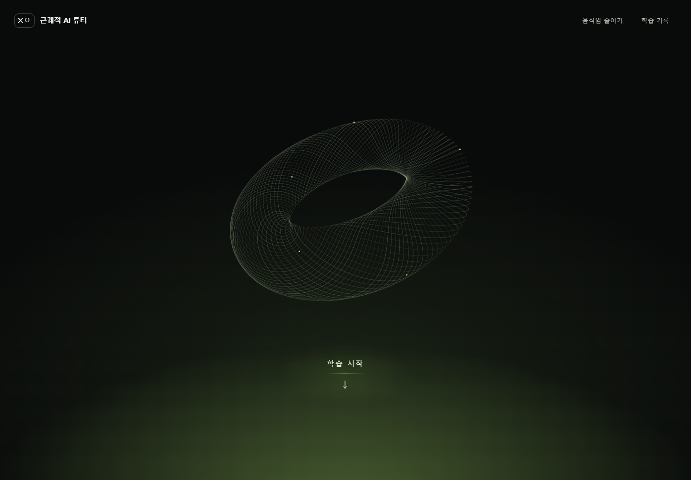
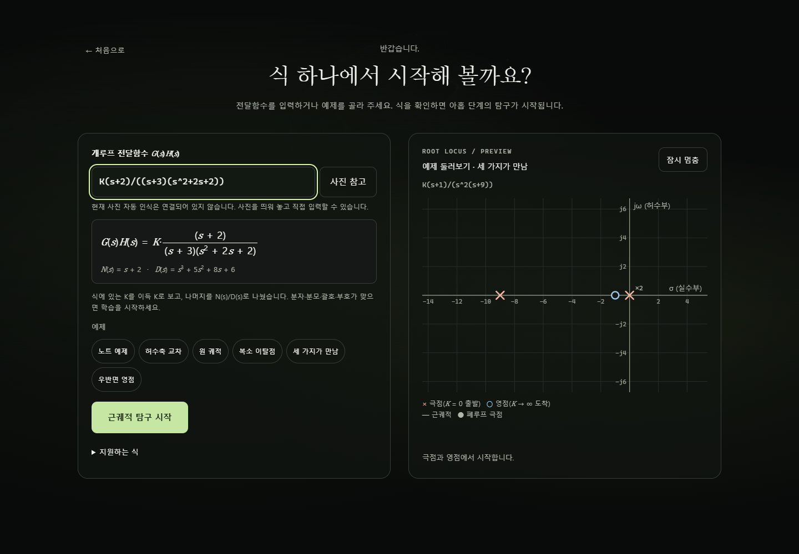
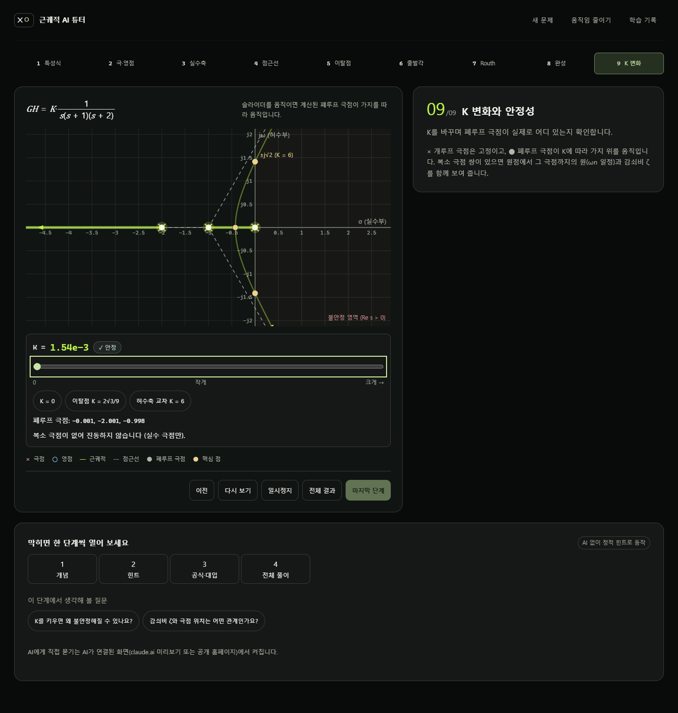
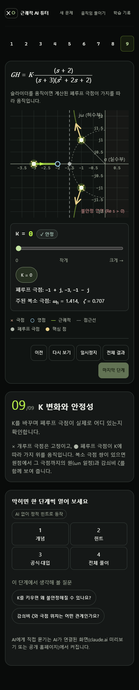

# 근궤적 튜터 — 물결과 천천히 드러나는 궤적

2026-11-13 KST · 담당: GPT / ChatGPT·Codex. 이 문서는 최종 구현의 완료 보고서입니다.

## 변경과 범위

기준은 PR #4의 `c4d3052704414286bfce094b53b178019278dce5`입니다. 기존 `gpt/quiet-depth` 작업을 이어갔으며 PR #3 디자인을 포함하는 기존 구현 위에서 수정했습니다. main 병합은 하지 않았습니다.

- 첫 화면의 곡면은 메뉴 아래와 시작 버튼 위 사이에 여백을 두고 맞춥니다. 회전 및 파동의 최대 변형을 고려한 투영 범위로 크기를 정합니다. 학습 중 창 크기를 바꿨다가 돌아와도 다시 맞춥니다.
- 커서에 붙어 함께 기울던 움직임을 제거했습니다. 포인터가 움직인 지점에서 작은 방사형 파동이 퍼지고 감쇠합니다. 최대 3개, 발생 간격 110ms 이상, 각 파동 수명 6초입니다. 포인터가 떠나도 갑자기 원위치로 튀지 않습니다. 터치와 모션 축소에서는 파동을 만들지 않습니다.
- 장식은 실제 근궤적이 아닌 32개 곡선으로 된 토러스형 수학 곡면입니다. 느린 기본 움직임은 사용자의 연속 모션 요청을 유지합니다. 첫 화면이 보일 때만 Canvas를 약 30Hz 이하로 그리며, 화면 밖·학습·숨겨진 탭·모션 축소에서는 연속 그리기를 멈춥니다.
- 경계 없는 시작 버튼, 실제 문서 스크롤, 스크롤 진행에 연동되는 배경 빛, 입력 패널의 일회성 안개 전환을 유지했습니다. 휠이나 터치를 가로채지 않고, 애니메이션 중에도 입력할 수 있습니다.
- 입력 화면의 공통 제목을 두 패널 위로 옮겼습니다. 데스크톱은 같은 폭·상단·하단을 갖는 두 패널, 좁은 화면은 자연스러운 세로 배치입니다. 학습 화면의 단일 K 조작부는 계속 그래프 바로 아래에 있습니다.
- ‘AI 연결 없음: 정적 힌트로 동작’은 시작 버튼 옆에서 제거했습니다. 사진 자동 인식 미연결 안내와 오프라인 정적 힌트는 유지했습니다.
- 인사는 기기 시각에 따라 아침/오후/저녁/밤 후보와 일반 인사 중 선택하고, 제목은 4가지 중 고릅니다. 페이지를 열 때 한 번 정하며 작업 중 바뀌지 않습니다. 실제 유효 학습 기록이 있을 때만 재방문 인사가 후보에 들어갑니다. 위치·감정 추정·네트워크 요청은 없습니다.
- 오른쪽 프리뷰는 기존 엔진으로 계산한 여섯 예제를 섞어 보여줍니다. 한 순회에 각 예제가 한 번씩 나오며, 새 순회의 첫 예제는 직전 것과 중복되지 않습니다. 약 20초 동안 극점·영점 → 점근선 → 가지 그리기 → 실제 K 변화 순으로 진행하고 끝에서 1.5초 동안 옅어집니다. 입력한 식과 별개인 ‘예제 둘러보기’임을 식·제목·접근성 이름으로 구분합니다.
- 입력·예제 선택·사진 인식 결과·기록 복원은 자동 프리뷰보다 우선합니다. 입력 중에는 예제 재생을 즉시 멈추고 현재 식의 극점·영점을 보여줍니다. 오류 시 이전 그림을 남기지 않습니다. ‘예제 둘러보기’로 다시 켤 수 있습니다.
- 프리뷰에는 일시정지가 있고 화면 밖·탭 숨김에서 시계와 SVG 애니메이션을 멈춥니다. OS/앱 모션 축소에서는 완성 그래프를 정지 상태로 보여주고 ‘다음 예제’로만 넘깁니다. 범례 ×/○/—/●를 유지·보강했습니다.

계산 엔진 `js/`와 `app/js/graph.js`, parser/content/ai/store는 변경하지 않았습니다. 지원 범위, 수식, 9단계, K=0, 학습 기록, 오프라인 학습은 유지합니다. 이미지·영상·폰트·외부 서비스·라이브러리를 추가하지 않았습니다.

## 변경 파일

| 구분 | 파일 | 내용 |
|---|---|---|
| 디자인 | `app/app.css`, `app/template.html`, `app/js/atmosphere.js` | 균형 배치, 파동, 경계 여백, 범례 |
| 기능 | `app/js/welcome-copy.js`, `app/js/preview-tour.js`, `app/js/main.js` | 인사, 실제 예제 재생, 입력 우선, 상태 연결 |
| 빌드·검증 | `tools/build.py`, `tools/journey-check.js`, `tools/fluid-check.js`, `tools/journey-performance.js` | 단일 HTML 통합 및 검증 |
| 산출물·기록 | `dist/rootlocus-tutor.html`, `tests/results.json`, `docs/shots/fluid-study/`, 본 문서, `docs/할일.md`, `docs/AI-사용기록.md` | 이번 빌드와 검사 결과 |

## 색상·타이포그래피


| 역할 | 토큰 / 값 |
|---|---|
| 배경 / 패널 / 보조 패널 | `--bg` #090B0A / `--surface` #151817 / `--surface2` #1D2220 |
| 패널 경계 / 격자 | `--line` #363E3A / `--grid` #252D29 |
| 본문 / 보조 / 약한 글자 | `--fg` #F3F5EF / `--muted` #B1B8AB / `--faint` #9BA593 |
| 주요 행동 / 버튼 글자 / 포커스 | `--accent` #C6E6A4 / `--accent-ink` #152007 / `--focus` #D7F7A4 |
| 극점 × / 영점 ○ | `--pole` #EFB49A / `--zero` #9ACBE8 |
| 궤적 / 파선 점근선 / 핵심 점 | `--locus` #BEF74B / `--asym` #A8AEAA / `--key` #ECD38D |
| 제외 후보 / 안정 / 경고 / 오류 | `--rej` #9DA697 / `--ok` #B8D8CB / `--warn` #E7C77E / `--bad` #FFADAD |

폐루프 극점 ●, 범례, 안정 상태의 문구·기호·채움 방식은 유지합니다. 시스템 한국어 글꼴을 사용하며 각 font-family의 마지막은 serif/sans-serif/monospace 계열입니다. 글꼴 자산 추가 0 bytes. 발표 PC와 iPad의 실제 글꼴 모양은 다를 수 있습니다.


## 이번 빌드 검증

Windows / Node 24.22.1 / Python 3.12.10 / Headless Chrome 157.0.8103.78. 단일 HTML을 `file://`로 열고 offline context에서 실행했습니다.

저장소 루트에서 실행:

```powershell
node tests/run-tests.js
node tests/ui-regressions.js
node --check app/js/main.js
node --check app/js/graph.js
node --check app/js/atmosphere.js
node --check app/js/preview-tour.js
node --check app/js/welcome-copy.js
python tools/build.py
git diff --check
node tools/journey-check.js
node tools/fluid-check.js
node tools/journey-performance.js
Get-FileHash dist/rootlocus-tutor.html -Algorithm SHA256
```

브라우저 검사에는 Node Playwright와 Chrome이 필요합니다. 별도 설치 경로는 `PLAYWRIGHT_MODULE`로 지정합니다. 이 환경은 기존 `work/python-deps/playwright/driver/package` 및 `work/pip-temp`를 사용했습니다. 앱 자체에는 검사 도구가 필요하지 않습니다.

- 엔진 17/17 문제, 225/225 항목. 기존 UI 회귀 6/6.
- 기존 오프라인 흐름 118항목: 오류→수정→학습, 6예제×9단계 제목·현재 단계 이동, K=0 왕복, 기록 복원/손상 방어, 정적 힌트, 모달 Tab 순환·복귀, 빠른 전환, 모션 설정 저장, 사진 참고. 외부 요청 0, 페이지/콘솔 오류 0.
- 추가 27항목: 경계 이탈 방지 6크기, 같은 폭·상하 정렬, 인사 시간대·방문 중 고정, 실제 가지 렌더링, 일시정지, 느린 장면 전환, 입력 우선·20초 이상 덮어쓰기 방지, 여섯 예제 셔플, 모션 축소.
- 1440×1000, 1194×834, 834×1194, 390×844, 360×740에서 가로 넘침 없음. K 조작부는 그래프 아래 16px. 추가로 876×812, 1440×900에서 곡면 여백을 확인했습니다.
- 동일 빌드의 첫/입력/학습/모바일 및 중요 그래프 형태를 캡처했습니다. 캡처를 직접 본 시각 검수와 54단계 제목·이동 자동 확인은 구분합니다. 전체 54장 상세 시각 검수는 하지 않았습니다.

실제 iPad/발표 PC/Safari, 화면 읽기 도구, 가상 키보드·안전 영역, 실제 탭 숨김 동작은 미검증입니다. 화면 크기·터치 에뮬레이션은 실기기 검증이 아닙니다.

## 성능 진단의 한계

1440×1000 Headless Chrome, file:// offline, bringToFront 후 시작/끝 visibilityState=visible. 첫 60프레임 뒤 합성 시작 클릭. rAF 180표본: 중앙값 6.9ms, p95 27.7ms, 최대 62.6ms, long task 0건. CDP 누적 Task 209.8ms, Script 39.6ms, Layout 8.7ms, RecalcStyle 22.0ms. 원시 결과는 `docs/shots/fluid-study/performance.json`입니다.

헤드리스 환경의 짧은 진단이며 실제 FPS·입력 지연·체감 부드러움을 보장하지 않습니다. 이전 원격 1016ms 수치는 사용하지 않았습니다. 발표 PC에서 마우스 이동, 첫 진입, 프리뷰 1분 재생, 모션 축소를 직접 확인해야 합니다.

## 빌드 식별

- 실행 소스 커밋: `29e29991147dd3519623c8a6f4bef68a24666c91`
- 빌드 명령: `python tools/build.py`
- 실행 파일: `dist/rootlocus-tutor.html`, 전달본 `outputs/rootlocus-tutor-fluid-study.html`
- 크기: 227,316 bytes. 직전 전달본 214,662 bytes 대비 12,654 bytes 증가. 폰트/영상/이미지 추가 0 bytes.
- SHA-256: `26376e4b75ad8b78e5dbf3d266cd41ae5f1a6728c4b9ff7dac7790ce8a9b9623`
- HTML 소스 입력 식별값: `c4f794ee15a87350266955260262e304bc2b050bfe58c4962b20dcae6ef4a7a7`
- 검사 JSON의 대상 해시는 위 실행 파일과 일치합니다. 파일 자신의 해시를 내부에 넣지 않습니다.
- 브랜치 `gpt/quiet-depth`, PR https://github.com/2sv8y5k7zg-svg/rootlocus-tutor/pull/4. main 병합은 사용자에게 남깁니다.





