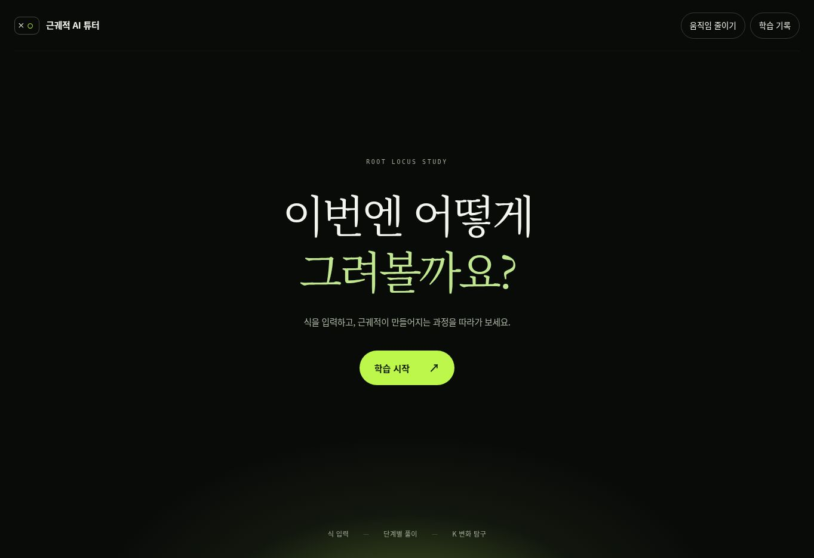
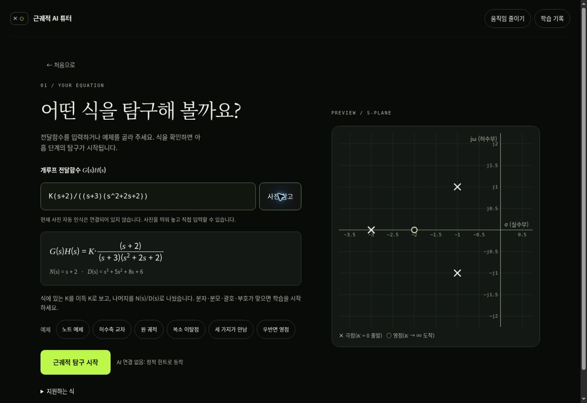
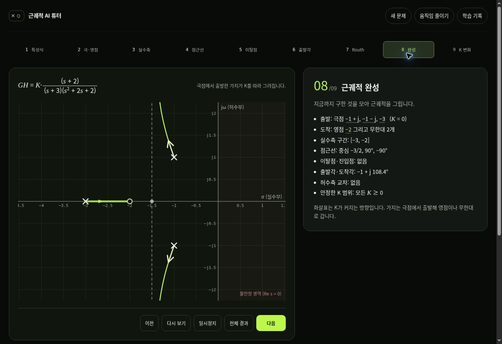

# 근궤적 튜터 — 간결한 블랙·그린 디자인

기준: 2026-11-12 KST. 담당: GPT. 기존 기능 수정 브랜치를 기반으로 한 디자인 제안이며 main에는 병합하지 않았습니다.

## 방향과 화면 구성

참고 이미지의 특징은 넓은 검정 공간, 큰 세리프 제목, 제한된 초록 강조, 하단의 조명, 원근감 있는 제품 패널입니다. 사용자의 최종 지시에 따라 떠 있는 제품 패널·사진·강한 광선을 제외했습니다. 첫 화면은 제목과 여백, 하단의 약한 빛, 하나의 시작 행동에 집중합니다.

- 첫 화면: `이번엔 어떻게 / 그려볼까요?` → 학습 시작.
- 입력: 전달함수·검증·수식 미리보기·예제·시작 버튼. 보조 그래프는 실제 극점/영점.
- 학습: 9단계 이동, 큰 그래프와 설명, 아래 정적 힌트/질문. 좁은 화면에서는 순서대로 배치.
- 그래프의 극점 ×, 영점 ○, 폐루프 극점 ●, 점근선의 파선 등 기존 의미 구분 유지. `js/` 계산 엔진과 parser/content/ai/store는 이번 디자인에서 변경하지 않음.

## 토큰

| 용도 | 값 |
|---|---|
| 배경 / 패널 | #090B09 / #141814 |
| 본문 / 보조 / 약한 글자 | #F3F5EF / #B1B8AB / #9BA593 |
| 강조 / 강조 위 글자 | #BEF74B / #152007 |
| 제목 강조 | #C1E890 |
| 패널 / 컨트롤 반경 | 18px / 10px |
| 버튼 반응 / 패널 / 화면 등장 | 160ms / 440ms / 540ms |
| 화면 전환 | opacity + translateY, 즉시 입력 가능 |
| 빛의 포인터 반응 | 좌우 최대 12px, 상하 최대 10px, 프레임당 1회 |

대비 계산: 패널 위 본문 16.33:1, 보조 8.81:1, 약한 글자 7.00:1. 주요 버튼 13.37:1. 이는 지정 색상의 계산값이며 전체 화면의 모든 요소를 자동 접근성 검사했다는 뜻은 아닙니다.

제목은 Noto Serif CJK KR / AppleMyungjo / Batang / Georgia 순서의 시스템 글꼴, 본문은 기기 한국어 산세리프, 수식은 Cambria Math / Times 계열을 사용합니다. 폰트 파일을 재배포하지 않으며 CDN 요청도 없습니다. 기기별 설치 글꼴에 따라 실제 획과 줄바꿈은 달라질 수 있습니다.

`app/app.css`는 토큰 → 공통 컨트롤 → 첫 화면 → 입력 → 학습 → 수식/그래프 → 반응형/모션 순서입니다. 이전 테마를 누적해서 덮어쓰던 블록을 교체했습니다. 현재 UI는 어두운 단일 테마입니다.

## 동작·접근성

- 화면을 숨길 때 해당 화면의 버튼은 탭 순서에서 제외됩니다. 입력 화면에서는 입력칸, 학습 시작에서는 단계 버튼으로 포커스를 이동합니다.
- 오류 입력에 aria-invalid, 설명 연결에 aria-describedby, 현재 단계에 aria-current를 사용합니다.
- 기록/예시 대화상자는 Tab/Shift+Tab 순환, Escape 닫기를 지원합니다. 기록 창을 닫으면 원래 버튼으로 돌아갑니다.
- OS의 동작 줄이기와 앱의 움직임 줄이기를 지원합니다. 앱 설정은 브라우저에 저장합니다. 터치에서 포인터 장식을 사용하지 않고 스크롤을 막지 않습니다.
- 일시정지는 그래프 애니메이션에만 적용해 화면 등장 효과가 멈춘 채 남지 않게 합니다.
- 사진 참고는 연결 상태를 명시합니다. 자동 인식은 기존 Claude 연결 환경에서만 가능하며 새로운 유료 API나 OCR을 연결하지 않았습니다. 자동 읽기 결과는 입력칸에 표시한 뒤 사용자가 확인해야 합니다.

## 확인한 결과

| 검사 | 결과 |
|---|---|
| node tests/run-tests.js | 17/17 문제, 225/225 항목 |
| node tests/ui-regressions.js | 6/6 |
| node --check main.js / graph.js | 통과 |
| Python build / git diff --check | 통과 |
| Chrome 실제 버튼 조작 | 6개 예제 × 9단계 = 54개 화면의 제목 및 단계 이동 확인 |
| K=0 왕복 | 9 → 8 → 9단계 후 0 유지 |
| 잘못된 식 | K^2/(s+1)의 시작 버튼 비활성 및 구체적 오류 표시 |
| 키보드 기록 창 | Shift+Tab 순환, Escape 후 기록 버튼 포커스 복귀 |
| 모션 축소 | 54단계 축소 상태 동작, 해제 후 새로고침 설정 유지 |
| 로컬 실행 의존 | 묶음에 외부 script/link/img 실행 자원 없음, 원격 AI 없이 정적 힌트 표시 |
| 페이지 오류 로그 | 최종 확인한 localhost 페이지 오류 없음. 브라우저 확장 자체 오류는 별도 |

Chrome iframe 크기 검사(기기 에뮬레이터나 실제 iPad 검사가 아님):

| 프레임 크기 | 실제 콘텐츠 폭 | 확인 화면 | 가로 넘침 |
|---|---|---|---|
| 390 × 844 | 첫 화면 390, 스크롤 화면 375px | 첫 화면 / 입력 / 9단계 | 0px |
| 834 × 1112 | 819px | 학습 | 0px |
| 1194 × 834 | 1179px | 입력 / 학습 | 0px |

### 성능 측정의 한계

원격 Chrome의 390px iframe에서 입력 → 학습 → 3단계 전환 중 requestAnimationFrame 간격을 8초 수집했습니다. 표본 13개, 중앙값 1016.37ms, 95백분위 1016.50ms, 최대 1016.50ms, 50ms 초과 9개였습니다. 탭 스케줄링 등 원격 환경의 영향을 배제할 수 없고 60fps 목표를 확인하지 못했습니다. 이 수치를 실기기 성능으로 해석하거나 성능 검증 통과로 표시하지 않습니다. 발표 컴퓨터의 활성 탭에서 DevTools Performance와 실제 조작으로 추가 확인해야 합니다.

### 미검증 / 남은 일

- iPad Safari, 실제 터치 제스처, 화면 읽기 도구, OS 설정을 통한 reduced-motion 전환.
- 사진 파일 선택은 브라우저 업로드 승인 거절로 진행하지 못했습니다. 실제 OCR도 미검증입니다.
- smoke.py는 첫 화면 진입에 맞춰 수정했으나 실행하지 않았습니다. 브라우저 검사는 별도로 수행했습니다.
- 네트워크를 강제로 차단한 실기기 파일 실행, 사진 API 응답, 극단적으로 긴 입력, 고배율 확대는 추가 확인 필요.
- 작은 화면에서 K 조작부와 그래프를 오가려면 스크롤이 필요합니다.

## 실행과 캡처

`python3 tools/build.py` → `dist/rootlocus-tutor.html`을 내려받아 브라우저로 열기. 빌드 결과도 함께 제공합니다. 호스팅, 외부 배포, 신규 API, 추가 과금 서비스는 없습니다.

