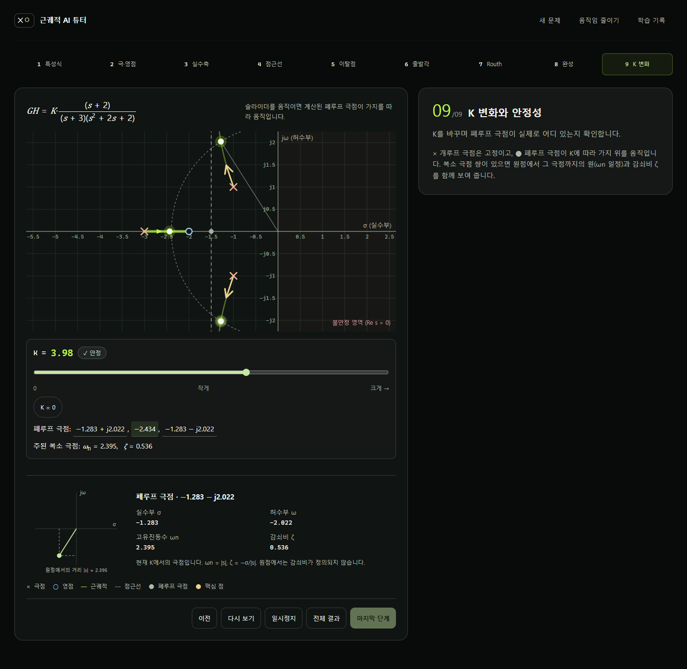
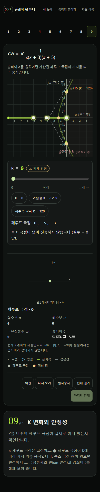

# 근궤적 튜터 — 점 선택과 일반 입력 검증

2026-11-13 KST · 담당: GPT / ChatGPT·Codex. 최종 구현과 실제 검사 결과입니다.

## 화면 변경

- AI 코치·힌트 사다리·채팅 패널을 제거했습니다. 9단계의 공식·대입·결과·‘왜 그런가요?’ 설명은 그대로 읽을 수 있습니다. 기존 내 답 확인과 간단한 예시 복귀는 설명 안의 접힌 ‘직접 확인하기’로 옮겼습니다. 네트워크 없이 학습을 마칠 수 있습니다.
- 그래프의 극점·영점·이탈점·허수축 교차·점근선 중심 또는 폐루프 극점 숫자를 선택하면 좌표 투영 그림이 나타납니다. 키보드 Enter/Space로도 선택합니다. 그래프는 접근성 그룹이며 선택 가능한 점은 버튼 의미·선택 상태를 갖습니다.
- 미니 그림은 원점→선택한 점 벡터, 실수부·허수부 투영을 보여줍니다. 극점에는 ωn=|s|, ζ=−σ/|s|를 표시합니다. 원점의 ζ는 ‘정의되지 않음’입니다. 영점·핵심 점에는 극점 감쇠비를 적용하지 않습니다. 전달함수의 시간 응답을 흉내 낸 그림이 아닙니다.
- 선택한 폐루프 극점은 K 변화에 따라 갱신되며, K 버튼을 누르면 실수부가 가장 큰 극점을 대표로 표시합니다. 단계 이동 시 이전 선택은 지웁니다. 패널이 화면 아래에 있으면 선택 시 가까운 위치로 이동하며 모션 축소를 존중합니다.
- 기존 물결 장식·입력 화면·실제 예제 프리뷰·9단계·단일 K 조작부·기록·사진 참고는 유지합니다. 사진 AI 연결부는 힌트 제거와 별개이며, 미연결 상태에서는 자동 인식인 척하지 않습니다.

## 계산 오류 수정 — UI와 분리

수학 수정 커밋: `6b71c67d06e4a607c62b7ea9f1deb986d79f8cb8`.

1. **중복 허수축 극점의 안정 판정**: `K/s²`, K=0에서 [0,0]을 기존 `classify`가 실수부만 보고 marginal(임계 안정)로 분류했습니다. 중복 허수축 극점에는 t^q·exp(jωt), q≥1의 커지는 항이 있으므로 unstable로 고쳤습니다. 단순 원점·단순 허수축 켤레쌍은 marginal, 음의 실수부 중근은 stable을 유지합니다. 수치 허용오차 1e-7×근 크기 안에서 중복을 비교합니다. 매우 가까운 서로 다른 근의 구분은 수치 해석의 한계가 있습니다.
2. **입력 수치 검사**: 중간 곱셈의 비유한 계수가 다항식 정리 과정에서 사라지기 전에 차단합니다. 실제 0과 매우 작은 0이 아닌 분모도 구분합니다. 정규화 오버플로, 극도로 작은 분자, 한 다항식 안의 1e12 초과 계수 크기 비, 지나치게 큰 중간 전개·긴 입력을 명시적인 안내로 거절합니다. 계산 가능한 범위 밖을 성공한 것처럼 표시하지 않습니다.
3. `2.5e-3` 같은 과학적 숫자 표기를 지원합니다. ‘K≤0 미지원’이라는 화면 안내는 ‘K<0 미지원, K=0 지원’으로 바로잡았습니다.

계산 엔진 변경은 `js/routh.js`의 안정 분류뿐입니다. 근 찾기·가지 계산·정답 파일 `tests/expected.json`은 변경하지 않았습니다. 입력 검증은 `app/js/parser.js`에서 수행합니다.

## 어떤 식을 계산하는가

예제 목록을 찾아 결과를 반환하는 프로그램이 아닙니다. 입력 문자열을 분자·분모 다항식으로 해석한 뒤 D(s)+K·N(s)=0의 근을 계산합니다.

- 지원: 연속시간, 음의 피드백, K≥0, 실수 계수, 분모 1~4차, 분자 차수≤분모 차수. 인수형·전개형·소수·과학적 표기. K가 없으면 전체에 곱한 것으로 취급합니다.
- 미지원: 5차 이상, 분자 차수가 더 큰 식, 극점·영점 상쇄, 음의 유효 이득/양의 피드백, 시간 지연·sin/exp 등 비다항식, 복소 계수. K=0은 지원합니다.
- 입력 한계: 2048자, 512토큰, 중간 다항식 최대 64차, 유한 계수 및 정밀도 검사. 중간 전개 제한은 최종 지원 차수를 늘린 것이 아닙니다.
- 예를 들어 `K(s+4)/(s^3+7s^2+14s+8)`은 분모에 (s+4)가 있어 상쇄 제한으로 거절됩니다. 이런 경우와 구현 오류를 구분해야 합니다.
- 부동소수점 계산이므로 모든 가능한 입력에서 정확성을 보증하지 않습니다. 큰 계수 차이, 거의 겹치는 근, 특수 Routh 행은 여전히 주의가 필요합니다. Routh 특수 행은 기존처럼 수치 근 판정을 함께 사용합니다.

## 독립 검산과 결과

`tests/general-inputs.js`는 엔진 답을 정답으로 복사하지 않습니다. 먼저 알려진 근으로 Q(s)를 만들고, N(s)와 K를 정한 뒤 D=Q−KN으로 문제를 구성합니다. 따라서 그 K에서 기대 근은 처음 정한 Q의 근입니다. 계수 전개·근 비교·잔차 계산을 테스트 자체에서 수행합니다.

- 구성 문제 160개 중 지원 범위인 153개는 파서→분석→폐루프 근→안정 상태·해당 안정 구간을 검사했습니다. 알려진 공통 근을 가진 7개는 상쇄 거절을 검사했습니다. 근 비교 허용오차는 2e-5×max(1,|근|)입니다.
- 별도의 새 식 10개는 전체 가지를 계산해 유한 좌표와 D+KN의 정규화 잔차<1e-7을 검사했습니다. 1~4차, 동일 분자·분모 차수, 우반면 극점, 중근, 허수축 극점, 적분기를 포함합니다.
- 비지원 식·수치 범위·긴 식·과학적 표기·안정 판정 회귀까지 **836항목 통과**.
- 기존 엔진 **17/17문제, 225/225항목**, 기존 UI 회귀 **6/6** 통과. 기존 기준 정답은 약화하거나 수정하지 않았습니다.
- Windows / Node 24.22.1 / Python 3.12.10 / Headless Chrome 157.0.8103.78, file:// offline: 기존 화면 흐름 **118항목**, 신규 선택·일반 입력 **124항목** 통과. AI 관련 검사는 제거된 패널의 부재와 오프라인 설명 보존으로 갱신했습니다.
- 신규 브라우저 검사에는 예제 밖의 식 11개×9단계, 음의 켤레 좌표, 키보드 선택, K에 따른 갱신, 단계 이동 초기화, K/s²의 K=0 불안정 표시, 원점 ζ 미정의, 수치 오류 차단을 포함합니다.
- 데스크톱 1440×1000, iPad 상당 1194×834·834×1194, 모바일 390×844·360×740: 가로 넘침 0, 그래프→K 간격 16px. viewport/터치 에뮬레이션이며 실기기는 아닙니다.
- 동일 빌드의 첫·입력·학습·파라미터·모바일을 캡처했습니다. 9단계 제목 이동 검사와 전체 시각 검수는 다릅니다. 실제 iPad/Safari/화면 읽기 도구/가상 키보드·안전 영역은 미검증입니다. 이번 빌드의 성능 측정은 하지 않았으며 이전 측정값을 재사용하지 않습니다.

저장소 루트에서:

```powershell
node tests/run-tests.js
node tests/ui-regressions.js
node tests/general-inputs.js
node --check app/js/main.js
node --check app/js/graph.js
node --check app/js/point-inspector.js
node --check app/js/parser.js
node --check js/routh.js
python tools/build.py
git diff --check
node tools/journey-check.js
node tools/point-check.js
Get-FileHash dist/rootlocus-tutor.html -Algorithm SHA256
```

브라우저 검사는 Node Playwright+Chrome이 필요합니다. 기존 설치를 `PLAYWRIGHT_MODULE`로 지정할 수 있습니다. 실행 HTML에는 검사 의존성·CDN·신규 서비스가 없습니다.

## 변경 파일

| 구분 | 파일 |
|---|---|
| UI·상호작용 | app/app.css, app/template.html, app/js/main.js, app/js/point-inspector.js |
| 계산 오류·입력 검증 | js/routh.js, app/js/parser.js |
| 검증·빌드 | tests/general-inputs.js, tests/general-input-results.json, tests/results.json, tools/build.py, tools/journey-check.js, tools/point-check.js |
| 산출물·문서 | dist/rootlocus-tutor.html, docs/shots/point-study/, README.md, docs/design-system.md, docs/할일.md, docs/AI-사용기록.md |

## 색상·타이포그래피


| 역할 | 토큰 / 값 |
|---|---|
| 배경 / 패널 / 보조 패널 | `--bg` #090B0A / `--surface` #151817 / `--surface2` #1D2220 |
| 패널 경계 / 격자 | `--line` #363E3A / `--grid` #252D29 |
| 본문 / 보조 / 약한 글자 | `--fg` #F3F5EF / `--muted` #B1B8AB / `--faint` #9BA593 |
| 주요 행동 / 버튼 글자 / 포커스 | `--accent` #C6E6A4 / `--accent-ink` #152007 / `--focus` #D7F7A4 |
| 극점 × / 영점 ○ | `--pole` #EFB49A / `--zero` #9ACBE8 |
| 궤적 / 파선 점근선 / 핵심 점 | `--locus` #BEF74B / `--asym` #A8AEAA / `--key` #ECD38D |
| 제외 후보 / 안정 / 경고 / 오류 | `--rej` #9DA697 / `--ok` #B8D8CB / `--warn` #E7C77E / `--bad` #FFADAD |

폐루프 극점 ●, 범례, 안정 상태의 문구·기호·채움 방식은 유지합니다. 시스템 한국어 글꼴을 사용하며 각 font-family의 마지막은 serif/sans-serif/monospace 계열입니다. 글꼴 자산 추가 0 bytes. 발표 PC와 iPad의 실제 글꼴 모양은 다를 수 있습니다.


## 빌드 식별

- 기준: PR #4 head `7165948ec5cc988aa5014e26058593bf6b82a069`.
- 실행 소스 커밋: `46d2e732d1bb23b5fa3dc23045718744bad538e9`. 수학 수정은 위 별도 커밋에 있습니다.
- 빌드: `python tools/build.py` → `dist/rootlocus-tutor.html`.
- 전달본: `outputs/rootlocus-tutor-point-study.html`, 231,170 bytes.
- SHA-256: `9cf6485b066611b903ef097ad15b0dca8fee1ab6e8a3356a5e1e985150c79f8a`.
- 브랜치: `gpt/quiet-depth`. PR: https://github.com/2sv8y5k7zg-svg/rootlocus-tutor/pull/4. main 병합 없음.
- 발표 PC에서 실제 클릭·K 조작·수식 입력·모션 축소·오프라인 재실행을 확인해 주세요.



